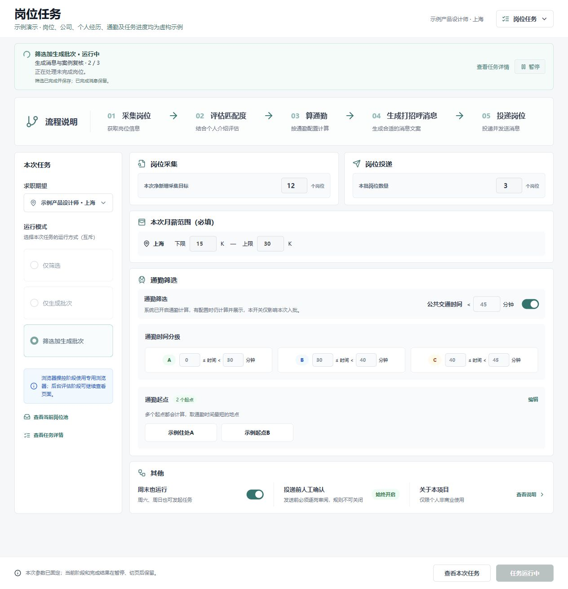
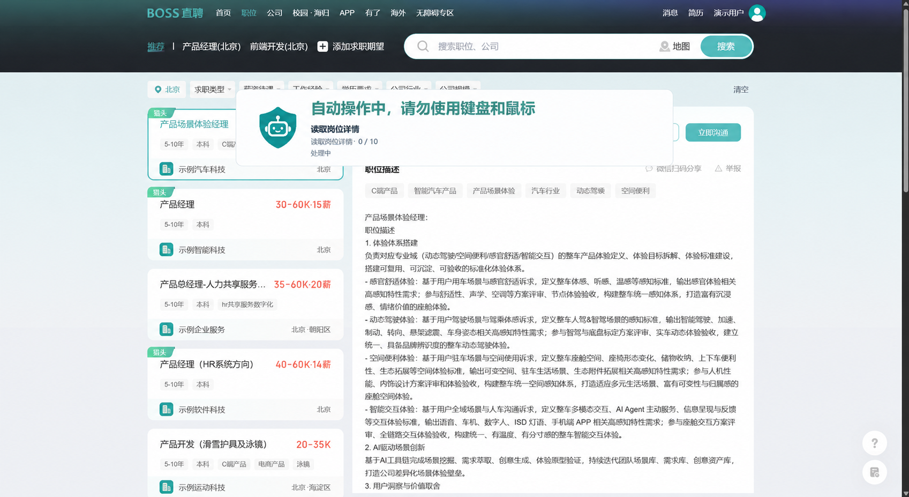
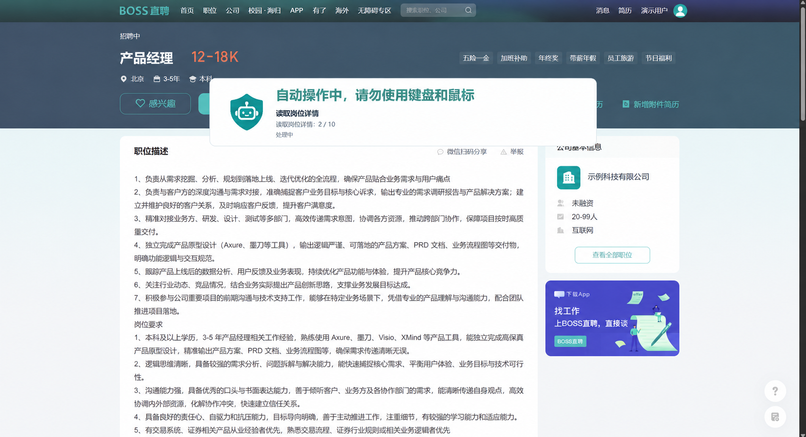
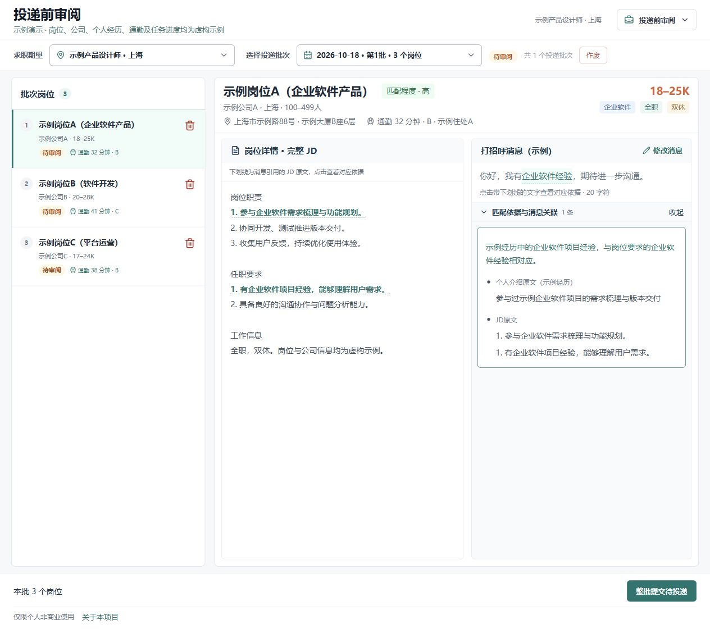
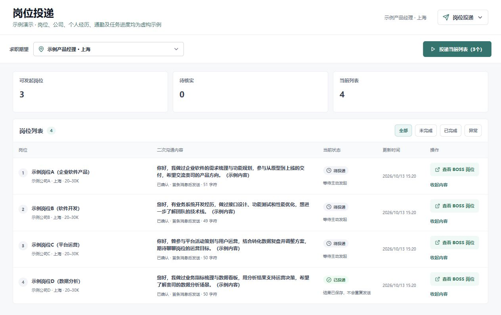

<h1 align="center">Boss Jobmate 职伴</h1>

> [!CAUTION]
> **允许非商业使用；未经另行授权，禁止商业使用。**
>
> 本项目用于探索 AI 辅助求职流程，请遵守招聘平台的使用规则。本项目与 BOSS 直聘无官方关联。
>
> 本项目采用 [PolyForm Noncommercial 1.0.0](LICENSE)，并提供[个人求职补充授权](NOTICE.md#个人求职补充授权)。

## 🎯 项目介绍

帮你自动找岗位、算通勤、测匹配，把合适的经历挑出来，跟 HR 打招呼，以此来尝试减少一些你求职过程的焦虑。

## ✨ 核心特点

### ⚙️ 流程自动

全流程由 AI 或程序自动完成，你只需要做必要的审核即可。

### 🚀 上手简单

解压即用，不需要自己搭建、部署等操作。根据初始化流程填写求职必要资料即可。

### 💰 费用可控

使用 DeepSeek API Key，申请和充值也容易，实测下来一次岗位自动化任务在 **0.1～0.2 元**。

### 🧠 反馈学习

如果你觉得 AI 错了，你可以提出修改，AI 会记住并后续避免犯相同错误。

## 📥 下载

**[前往 Releases 下载](https://github.com/Muhah99/boss-jobmate/releases)**

安装包待上传。

## 🖼️ 项目截图

以下展示职伴的主要使用流程。三张职伴界面图使用虚构示例数据；两张浏览器操作截图已替换个人及公司信息。实际界面以发布版本为准。

### 1. 创建岗位任务

选择求职期望，设置筛选条件与通勤要求，查看自动处理进度。

#### 自动读取岗位的工作画面

程序在浏览器中读取岗位列表与职位详情，并显示当前处理进度。以下为脱敏后的操作示意截图。

**读取岗位列表**

**读取职位详情**

### 2. 审阅岗位与沟通内容

查看岗位匹配依据、通勤结果和生成的打招呼消息，审核后再确认投递。

### 3. 查看投递状态

集中查看投递状态与沟通内容。图中以产品、开发、运营和数据分析四类岗位为例，展开展示结合岗位特点编写的消息。

## 🛠️ 使用说明

### 使用前准备

- **招聘账号**：使用前需要自行先在 BOSS 上维护好简历和求职期望。
- **系统**：目前暂时仅支持 Windows 系统。
- **AI 服务**：初版仅接入了 DeepSeek API 和 Codex CLI，DeepSeek 申请比较方便，后续如果使用的人多了，再根据需求接入对应的 AI 服务。
- **通勤计算**：如果需要计算通勤，可根据初始化教程，去申请百度地图开发者账号及相应 API Key，免费账号每天可用 100 次，作为日常使用足够。

## 🔐 数据隐私说明

### 使用量统计

设计上会向腾讯云 CloudBase 统计接口提交请求，由服务端获取 IP 地址，按日期统计访问次数（PV）和去重 IP 数（UV），用于了解每日使用情况。**去重 IP 数不等于实际人数。**

### AI 处理

整理经历、匹配岗位与生成消息时，相关个人资料、JD 和消息内容会发送至你配置的 AI 服务。

### 地图服务

启用通勤计算时，会向地图服务发送计算路线所需的地点信息。

> [!NOTE]
> 统计的实际启用状态、触发时机、保存期限和关闭方式，将在正式发布前补充核对。

## 💬 问题反馈

遇到问题或有功能建议，请前往 **[Issues](https://github.com/Muhah99/boss-jobmate/issues)**。

反馈时请附上：

1. 软件版本。
2. 操作步骤。
3. 错误提示。

附图时请遮挡个人资料及 API Key。
